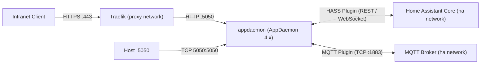

# AppDaemon

> Version: `4.5.13` | Image: `acockburn/appdaemon:4.5.13` | Upstream: https://github.com/AppDaemon/appdaemon

Python execution environment for Home Assistant (`HASS` plugin) and MQTT (`MQTT` plugin) home automation apps on `ha.vm.xbhl.intranet`, serving the AppDaemon Admin UI, REST API, and HADashboard.

## Service Overview

| Property | Value |
| :--- | :--- |
| **Domain** | `https://appdaemon.ha.intranet.xbhl.online` |
| **Primary Node** | `ha.vm.xbhl.intranet` (`Proxmox VM`) |
| **Deploy Path** | `/opt/containers/appdaemon` |
| **Ingress Strategy** | `Direct Ingress` (Traefik `websecure` router `appdaemon-router` on `proxy` network; host port `5050:5050` also published) |
| **Topology Archetype** | `Standalone Application` |
| **Authentication** | `None` (`admin`, `api`, and `hadashboard` enabled without HTTP password or forward-auth middleware; intranet-only endpoint) |
| **Ecosystem** | Not registered in WUD (no `wud.*` labels), Gatus, Homepage, or Authelia |

## Architecture & Communication

- **Networking**: Joins external Docker networks `proxy` (Traefik `appdaemon-router` targeting container port `5050` via `SERVICE_PORT`) and `ha` (ensured by `.preconfigure-run-script` in `.gitlab-ci.yml`), while also publishing `${PUBLIC_PORT}:${SERVICE_PORT}` (`5050:5050`) on the host.
- **Configuration & Plugins**: `src/docker-compose.yml` mounts `./config/appdaemon.yaml` to `/conf/appdaemon.yaml` via Docker Compose `configs:`. `appdaemon.yaml` interpolates location/timezone (`LATITUDE`, `LONGITUDE`, `ELEVATION`, `TZ=Europe/Warsaw`) and plugin settings via `!env_var`:
  - `HASS` (`type: hass`): connects to `HASS_URL` with `HASS_TOKEN` (`cert_verify: True`).
  - `MQTT` (`type: mqtt`, `namespace: mqtt`): connects over TCP to `${MQTT_HOST}:1883` (`MQTT_PORT` default `1883`) using `MQTT_USER`, `MQTT_PASSWORD`, and `MQTT_CLIENT_ID` (`app_daemon` in production; rewritten to `appdaemon_test` during CI `test`-stage jobs).
- **Volumes & Logs**: Uses `driver: local` (`type: none`, `o: bind`) named volumes `apps` (`./apps` -> `/conf/apps:ro`) and `logs` (`./logs` -> `/conf/logs`), plus `/etc/localtime:/etc/localtime:ro`. Writes 4 rotating log files (`appdaemon.log`, `error.log`, `diag.log`, `access.log`, `1000000` bytes x `3` generations each) under `/conf/logs/`.
- **Healthcheck**: Probes `http://127.0.0.1:${SERVICE_PORT}` (`5050`) via `wget --quiet --spider` (`interval: 5s`, `timeout: 60s`, `retries: 10`, `start_period: 5s`).

## Custom Apps & Unit Testing

- **Active Apps (`src/apps/apps.yaml`)**:
  - `home_model` (`home_model_app.HomeModelApp`): initializes the `models.home.Home` room/device model (`LivingRoom`, `Office`, `Bedroom`, `Hall`, `Storage`) wrapping Zigbee2MQTT (`Zigbee2MqttLight`, `MqttButton`, `MqttContactSensor`), Govee2MQTT (`GoveeMqttLight`), Tasmota (`TasmotaSwitch`), and Shelly (`ShellySwitch`) MQTT topics via `self.get_plugin_api("MQTT")`.
  - `office_lights_automation` (`office_lights.OfficeLightsAutomation`): synchronizes state bidirectionally between `light.office_floor_rgb_lamp` (`HassLight`) and the Office Tasmota wall button (`iot/tasmota/office_light/stat/POWER2` and `iot/tasmota/office_light/cmnd/POWER2`).
  - `bedroom_lights_automation` (`bedroom_lights.BedroomLightsAutomation`): binds left/right Zigbee2MQTT bedside buttons (`single`, `double`, `hold`) to `light.bedroom_rgb_lamp` brightness presets and the Hall Shelly main light.
- **Inactive Apps**: `storage_lights`, `living_room_led_strips`, and `ambient_lights_automation` are commented out in `src/apps/apps.yaml` while retaining their Python modules and unit tests under `src/tests/`.
- **Running Unit Tests**: `./scripts/run_tests.sh` creates `.venv`, installs `pytest`, sets `PYTHONPATH="$(pwd)/src:$PYTHONPATH"`, and runs `pytest src/tests/`. In CI, `test:appdaemon:unittests` (`python:3`) runs this script and gates `deploy:appdaemon:deploy-files`. `src/tests/test_project_structure.py` mocks `hassapi` and `mqttapi`, verifies every `src/apps/` subdirectory contains `__init__.py`, and checks that all uncommented `src/apps/apps.yaml` entries resolve to importable modules and classes.

## Required GitLab CI/CD Variables

All required variables are inherited from parent GitLab group scope (`0` project-level overrides):

| Variable | Consumed By | Purpose |
| :--- | :--- | :--- |
| `SSH_USER` | `docker-compose-service-deployment` | SSH username for `ha.vm.xbhl.intranet` |
| `SSH_PRIVATE_KEY` | `docker-compose-service-deployment` | SSH private key for `ha.vm.xbhl.intranet` |
| `CLOUDFLARE_ZONE_ID` | `docker-compose-service-deployment` | Cloudflare zone ID managing `xbhl.online` DNS |
| `CLOUDFLARE_DNS_API_TOKEN` | `docker-compose-service-deployment` | Cloudflare API token for `appdaemon.ha.intranet.xbhl.online` DNS management |
| `HA_INTERNAL_URL` | `setup:generate-build-artifacts` (`HASS_URL`) | Internal Home Assistant URL consumed by the `HASS` plugin |
| `HA_API_TOKEN` | `setup:generate-build-artifacts` (`HASS_TOKEN`) | Long-lived Home Assistant access token for the `HASS` plugin |
| `MQTT_HOSTNAME` | `setup:generate-build-artifacts` (`MQTT_HOST`) | MQTT broker hostname consumed by the `MQTT` plugin |
| `MQTT_USERNAME` | `setup:generate-build-artifacts` (`MQTT_USER`) | MQTT broker username |
| `MQTT_PASSWORD` | `setup:generate-build-artifacts` (`MQTT_PASSWORD`) | MQTT broker password |

## Upgrades & Maintenance

- **Upstream & Wrapper Sources**: Image `acockburn/appdaemon` is published from [AppDaemon/appdaemon Releases](https://github.com/AppDaemon/appdaemon/releases) (no `wud.*` labels in `src/docker-compose.yml`); config schema and plugin API breaking changes are documented in [AppDaemon Release History](https://appdaemon.readthedocs.io/en/latest/HISTORY.html).
- **Version & Flavor Constraints**: Upstream `acockburn/appdaemon` numeric SemVer tags (no `v` prefix or distro suffix); custom apps under `src/apps/` depend on `import hassapi as hass` (`hass.Hass`) and `self.get_plugin_api("MQTT")`.
- **Intentional Choices (Do Not Propose)**: Commented-out app blocks in `src/apps/apps.yaml` (`storage_lights`, `living_room_led_strips`, `ambient_lights_automation`) remain intentionally inactive while keeping their modules and unit tests; `delete-existing-container-files: true` in `.gitlab-ci.yml` is intentional because `src/apps` and `src/config` are repo-managed (making `/conf/logs` ephemeral across redeploys).
- **Upgrade & CI Gotchas**: Legacy `src/` layout with `setup:generate-build-artifacts`, `.preconfigure-run-script` (`ha` bridge network), and `deploy:appdaemon:deploy-files.needs` gated on `test:appdaemon:unittests` (`./scripts/run_tests.sh`); `default.before_script` mutates `$BUILD_ARTIFACTS_DIR/.env` (`MQTT_CLIENT_ID=appdaemon_test`) in every `test`-stage job (do not add `needs: []` to `test:appdaemon:unittests` without `before_script: []`); keep `src/logs/.gitkeep` tracked so the `o: bind` volume `device: ./logs` exists in CI DinD and fresh deploys; `test_project_structure.py` requires `__init__.py` in every `src/apps/` subdirectory and uses a flat line parser on `apps.yaml` (no `pyyaml`); hardcoded `http.url` port `5050` in `src/config/appdaemon.yaml` must match `SERVICE_PORT` in `src/.env`.
