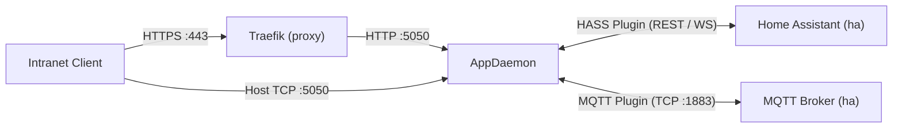

# AppDaemon

> Version: `4.5.13` | Image: `acockburn/appdaemon:4.5.13` | Upstream: https://github.com/AppDaemon/appdaemon

Python automation daemon paired with Home Assistant and MQTT on `ha.vm.xbhl.intranet`, running custom room/lighting automations and serving the Admin UI, REST API, and HADashboard.

## Overview

| Property | Value |
| :--- | :--- |
| **Domain** | `https://appdaemon.ha.intranet.xbhl.online` |
| **Node** | `ha.vm.xbhl.intranet` |
| **Ingress** | Direct Traefik `websecure` (`proxy` network) + host TCP `:5050` |
| **Authentication** | None (unauthenticated Admin UI, API, and HADashboard; intranet-only) |
| **Ecosystem** | Unmonitored in WUD, Gatus, Homepage, and Authelia |

## Architecture & Key Decisions

- **Home Automation & MQTT Runtime**: Bridges Home Assistant (`HASS` plugin) and the MQTT broker (`MQTT` plugin) over the external `ha` Docker network to drive room-level device models and synchronize Zigbee2MQTT, Govee2MQTT, Tasmota, and Shelly lighting states.
- **Git-Tracked Config, Apps & Unit Tests**: `src/config/appdaemon.yaml` and custom Python apps under `src/apps/` are versioned directly in Git; `./scripts/run_tests.sh` bootstraps a local `pytest` virtualenv with mocked `hassapi`/`mqttapi` modules and gates CI deployments (`test:appdaemon:unittests`).
- **Intranet Ingress, Auth & Health Posture**: Exposed internally via Traefik on `proxy` alongside direct host port `:5050` without HTTP or forward-auth middleware, using the stock upstream image and an in-container `wget --spider` HTTP healthcheck on `:5050`.

### External Credentials

- **Home Assistant Access Token**: Requires a manually generated Home Assistant long-lived access token (`HA_API_TOKEN`) and internal endpoint (`HA_INTERNAL_URL`) from `home-automation` group CI variables.
- **MQTT Broker Credentials**: Consumes `home-automation` group MQTT broker endpoint and user credentials (`MQTT_HOSTNAME`, `MQTT_USERNAME`, `MQTT_PASSWORD`), automatically overriding the MQTT client ID in CI `test`-stage jobs to avoid disconnecting production.

## Upgrades & Maintenance

- **Upstream & Wrapper Sources**: Image `acockburn/appdaemon` tracks [AppDaemon Releases](https://github.com/AppDaemon/appdaemon/releases) (unmonitored by WUD; no `wud.*` labels); review [AppDaemon Release History](https://appdaemon.readthedocs.io/en/latest/HISTORY.html) for config or plugin API changes.
- **Version & Flavor Constraints**: Pin upstream numeric SemVer tags on `acockburn/appdaemon` (no `v` prefix or distro suffix); custom apps rely on `hassapi` (`hass.Hass`) and `self.get_plugin_api("MQTT")`.
- **Intentional Choices (Do Not Propose)**: Commented-out app blocks in `src/apps/apps.yaml` (`storage_lights`, `living_room_led_strips`, `ambient_lights_automation`) remain intentionally inactive while retaining their Python modules and unit tests.
- **Upgrade & CI Gotchas**: Legacy `src/` layout creates the external `ha` network via `.preconfigure-run-script`, gates deploys on `test:appdaemon:unittests`, and mutates artifacts in `default.before_script` for all `test`-stage jobs (never add `needs: []` without `before_script: []`); keep `src/logs/.gitkeep` tracked, keep `__init__.py` in every `src/apps/` package (`test_project_structure.py` parses `apps.yaml` without `pyyaml`), and keep `http.url` (`:5050`) in `src/config/appdaemon.yaml` aligned with the container listener port.
